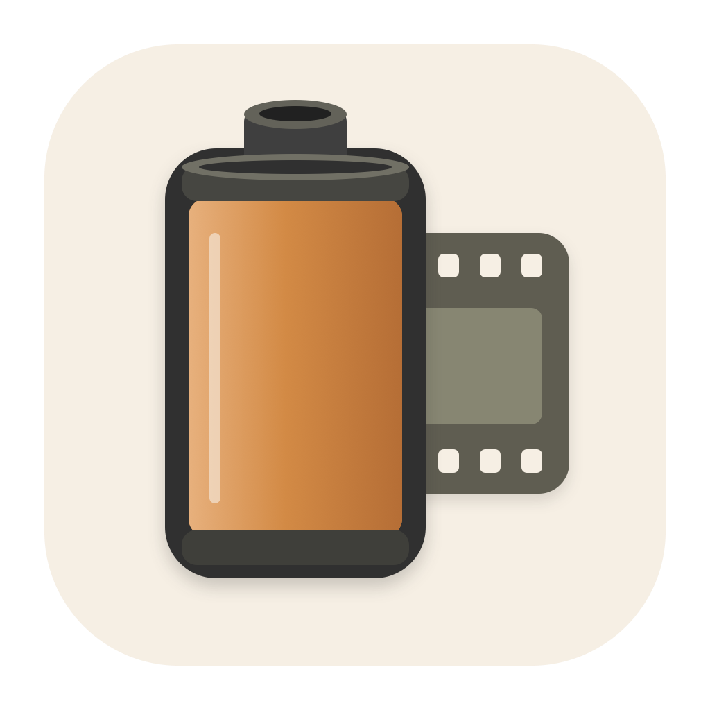
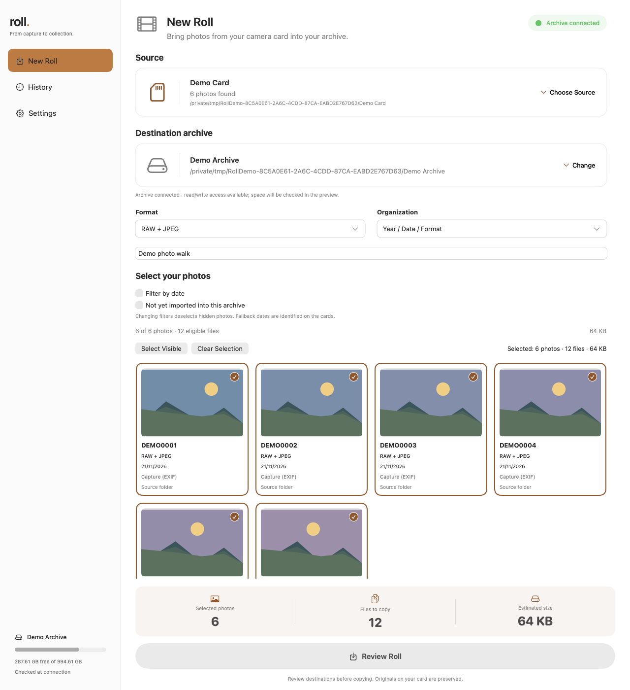

<p align="center">
  
</p>

<h1 align="center">Roll</h1>
<p align="center"><strong>From capture to collection.</strong></p>

A native macOS app for importing, organizing and preserving photographs.
Built for photography enthusiasts, inspired by analog photography.

Roll brings photographs from your camera card into an ordinary folder archive,
with visual selection, RAW + JPEG grouping and verified copying to an external SSD.
Your files remain accessible in Finder.

## A look at Roll



[Selection and filtering](docs/screenshots/selection-light.png) ·
[Import progress](docs/screenshots/progress-light.png) ·
[History](docs/screenshots/history-light.png) ·
[Settings](docs/screenshots/settings-light.png) ·
[Dark mode](docs/screenshots/import-dark.png)

These are native captures of the actual SwiftUI views using an isolated demo harness and
code-generated illustrations, not personal photographs or design mockups.
[Capture method and reproduction](docs/screenshots/README.md).

## Why Roll?

Roll began with a photography enthusiast's practical problem: returning from a camera outing
with hundreds of photographs, choosing RAW and JPEG files, and organizing them on an external
SSD without a proprietary catalog or a complicated professional workflow.

A roll is an import session: a trip, an event, or an afternoon spent taking photographs.
The analog reference is a reminder to keep the process simple and intentional.

## Features

- Discover JPG, JPEG and Panasonic RW2 files recursively, including inside DCIM.
- View RAW + JPEG pairs as one photo while retaining each original file.
- Filter by capture date and format, select photos, and preview destination paths before copying.
- Organize by date, optional year/event, and optional RAW/JPEG folders; preserve filenames.
- Verify copies by size and SHA-256 before publishing final files, without overwriting existing content.
- Compare existing content, review per-file history, and prepare recovery for interrupted imports.
- Remember an authorized archive folder and check its identity when reconnecting.
- Use native macOS controls, light/dark appearances, and English or Brazilian Portuguese.

## How it works

1. Choose a card or source folder and your archive folder.
2. Select photos and formats, optionally filter by date or add an event name.
3. Choose **Review Roll** and check paths, file counts, estimated size and available space.
4. Choose **Import Roll**. Roll copies into exclusive temporary files, verifies their content,
   and finalizes without replacing another file.
5. Review the result. History can verify the current destination or prepare another attempt.

A typical archive looks like this:

```text
Archive/
└── 2026/
    └── 2026-11-21 - Photo walk/
        ├── RAW/P100001.RW2
        └── JPEG/P100001.JPG
```

**Roll never erases your SD card. A verified import is not an independent backup.**

## Getting started

This first public source release is being prepared as **v0.1.0**. There is no public binary download yet.
Build from source, run Roll, and authorize your source and archive using the native folder pickers.
Start with disposable folders before using your everyday archive.

### System requirements

- macOS **27.0 or later** (the current deployment target).
- Xcode **27.0** with the macOS SDK; verified locally with Swift **6.4**, in Swift 6 language mode.
- Apple Silicon for the verified build and local packaging script.

No external packages, Apple account or provisioning profile are required for local ad hoc signing.
Intel and older macOS versions have not been validated. These are the project's current requirements,
not a claim that every feature inherently needs macOS 27.

### Building from source

```sh
git clone https://github.com/lucascacao95/roll.git
cd roll
xcodebuild -project PhotoImporter.xcodeproj -scheme PhotoImporter \
  -destination 'platform=macOS,arch=arm64' -derivedDataPath build/DerivedData \
  CODE_SIGN_STYLE=Manual CODE_SIGN_IDENTITY=- build
open build/DerivedData/Build/Products/Debug/Roll.app
```

The repository remains private during preparation; cloning requires access until publication is approved.
You can also open `PhotoImporter.xcodeproj` and run the shared **PhotoImporter** scheme.
Internal names remain stable for compatibility; the application is **Roll**.

[Build, test and distribution instructions](docs/BUILDING.md) ·
[Detailed import behavior](docs/IMPORT_GUIDE.md) · [Architecture](docs/ARCHITECTURE.md)

## Project status and limitations

Roll is an early personal project, preparing its first public release. Local tests cover the
critical import, conflict and recovery paths using disposable directories.

- RW2 metadata and thumbnails depend on the camera model and macOS ImageIO support;
  unavailable previews use a placeholder. Synthetic RAW fixtures do not validate RAW decoding.
- Physical drive removal during a copy, power loss, and forced process termination need further hardware testing.
- EXIF dates use camera civil time; filesystem dates are explicitly labeled fallbacks.
- Duplicate filtering verifies recorded paths and their current content; it does not index the entire archive.
- Copies preserve file bytes, including embedded EXIF/GPS if present. Roll is not a metadata scrubber.
- Accessibility and the revised UI still need complete manual keyboard/VoiceOver verification.
- The icon is original code-generated artwork; the local history has been sanitized. The private remote has been updated and CI passed; public visibility awaits final maintainer review.
- Local DMGs are ad hoc signed, without Developer ID signing or Apple notarization.

See the [release readiness report](docs/RELEASE_READINESS.md) for evidence and remaining gates.

## Philosophy

**Your photographs. Your files. Your collection.**

Roll handles the journey from card to archive. It does not edit photographs, maintain a proprietary
photo catalog, synchronize to a cloud, or manage backups. You decide where your photographs live.

## Contributing and security

Read [CONTRIBUTING.md](CONTRIBUTING.md) before changing file operations.
For safety or privacy issues, follow [SECURITY.md](SECURITY.md); never attach personal photos,
bookmarks or real import records to a public issue.

## License

Current code, documentation and original code-generated artwork are licensed under the [MIT License](LICENSE).
See [asset provenance](docs/ASSETS.md) and the completed local [history cleanup](docs/ICON_MIGRATION.md).
The remote remains private after a passing CI run, pending final publication review.
