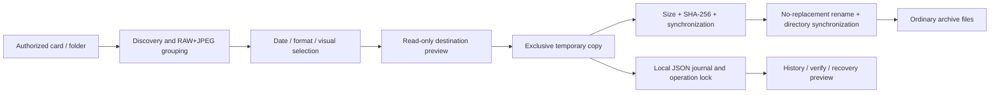

# Architecture

Roll is a sandboxed SwiftUI macOS app with ordinary files as its archive. There is no database,
proprietary catalog, external dependency, network client or background backup service.
The project/target/module remain PhotoImporter; the product and executable are Roll.

## Components

| Responsibility | Implementation |
| --- | --- |
| App, About, navigation and branding | PhotoImporterApp, BrandIdentity, AppLayout, DiscoveryView |
| UI state and task invalidation | DiscoveryModel, HistoryModel (`@MainActor @Observable`) |
| Discovery and pairing | PhotoScanner actor, Photo/PhotoGrouper |
| Dates and previews | PhotoMetadataReader, PhotoFilters, ThumbnailLoader actor |
| Read-only destination planning | ImportPlanner actor, PlanningPaths, ImportNaming |
| Verified copying and filesystem access | Shared ImportService actor, SafeImportFiles |
| Operation records and recovery | ImportRecord/ImportJournal, ImportHistory, HistoryTypes |
| Preferences and authorized volumes | AppPreferences, LibraryAccess, SavedLibrary, VolumeMonitor |
| Localization | Localization.swift, Localizable.xcstrings (en, pt-BR) |

UI models own cancellable tasks and revision/session IDs so stale scans, plans and checks cannot
replace current state. Discovery, planning, decoding and copy/hash loops run through serial actors.
The shared import actor has no suspension while it owns file descriptors, serializing imports across windows.
Progress is sent back to the main actor. Thumbnail decoding is serial with a bounded in-memory cache.
Library bookmark resolution and volume property queries remain synchronous on the main actor; slow or
unresponsive storage may cause UI stalls. Measure before changing access ownership or introducing caching.

## Discovery, dates and selection

Recognize JPG/JPEG/RW2 extensions without case sensitivity. Pair by relative source directory plus
case-preserved stem, retaining simultaneous JPG and JPEG variants. Hidden files, packages and symlinks
are skipped. A grouped photo can represent several physical files; format filters control copying.
EXIF DateTimeOriginal takes priority across the whole group, then DateTimeDigitized, creation, modification.
JPEG breaks equal-priority ties. Camera dates remain civil times without timezone conversion;
filesystem fallbacks use local time and are labeled. Narrowing a filter removes hidden selections.
Unsupported ImageIO decoding produces a placeholder and does not prevent byte-preserving import.

## Import protocol

1. Read-only planning validates roots, overlap, selected paths, naming, Unicode/case collisions and capacity.
   It snapshots identities and timestamps. It does not create files, reserve space or prove duplicates.
2. Revalidate root/volume identities and source snapshots. Persist intended paths and exclusive temporary
   names in a versioned journal before any archive writes.
3. Open originals read-only and traverse with no-follow descriptors. Create the temporary file exclusively
   in its final parent. Copy using a bounded 1 MiB buffer while hashing source data.
4. Synchronize, reread the entire temporary file, and compare size and SHA-256. Persist the verified state.
5. Revalidate the source, roots, parent and temporary identity. Finalize using `renameatx_np(RENAME_EXCL)`;
   no fallback permits replacement. Synchronize the parent before recording success.
6. Existing files are preserved. Full source/destination hashes and stable snapshots are required for
   `alreadyPresent`. A matching filename, byte count or old record is insufficient.

Cancellation cleans only the current unpublished temporary file; already verified final files remain.
Severe I/O/capacity or journal errors stop the operation. Other per-file conflicts can yield partial results.
A failure after publication may leave an intact file with a failure result; retry verifies content rather
than assuming that the journal and destination agree. Hardware durability depends on the filesystem/device;
fsync is not a claim of power-loss certification. No source-writing fallback exists.

## Local persistence and access

UserDefaults stores defaults and a security-scoped archive bookmark, with folder inode/birth time and
volume UUID (device identity fallback). The saved display path is never used to silently restore access.
Reconnection resolves without UI or auto-mounting, validates identity and renews stale bookmarks only
after validation. Source authorization is per selection and is not persisted by Roll.

Keep bundle ID `local.lucas.PhotoImporter`, preference keys and sandbox identity compatible.
The `local.lucas` component is a legacy public-facing identifier, not a secret or signing team.
Journals remain in the sandbox's Application Support `PhotoImporter/Imports` path, one atomic JSON per
operation, schemas 1 and 2. They store private paths, identities, hashes and per-file outcomes locally.
Do not publish them. The archive contains only the imported files and normal folders, with no index.

NSWorkspace mount/unmount/rename events trigger access refresh and invalidate the previous discovery/preview.
During copying the engine keeps its own scoped leases and revalidates independently; UI reconnection waits
until completion. A drive with the same name is not sufficient evidence of identity. No event starts a copy.

## Reconciliation and recovery

Recorded outcomes are immutable evidence of that operation, separate from current destination checks.
Reconciliation hashes current files. Recovery requires explicit source/archive confirmation, validates
identities and source content, retains recorded destinations, excludes intact copies and prepares a new
linked operation for user review. Active operation locks prevent concurrent recovery or cleanup.
Unverifiable legacy records fail closed. Cleanup considers only exact recorded temporary names with matching
identities/birth times, bounded size and no extra hard links, and rechecks approval before deleting.
The not-yet-imported filter verifies current source and recorded destination paths per physical file;
it does not scan the entire archive for global duplicates.

## Intentional boundaries

Do not rename internal modules or migrate persistence for branding. No SwiftData/SQLite or broad refactor
is needed for publication. Safety-sensitive changes require regression tests against real temporary files.
See [import details](IMPORT_GUIDE.md), [build/tests](BUILDING.md) and [release evidence](RELEASE_READINESS.md).
